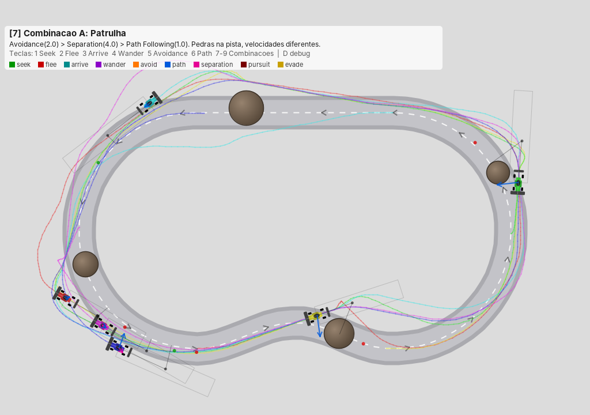
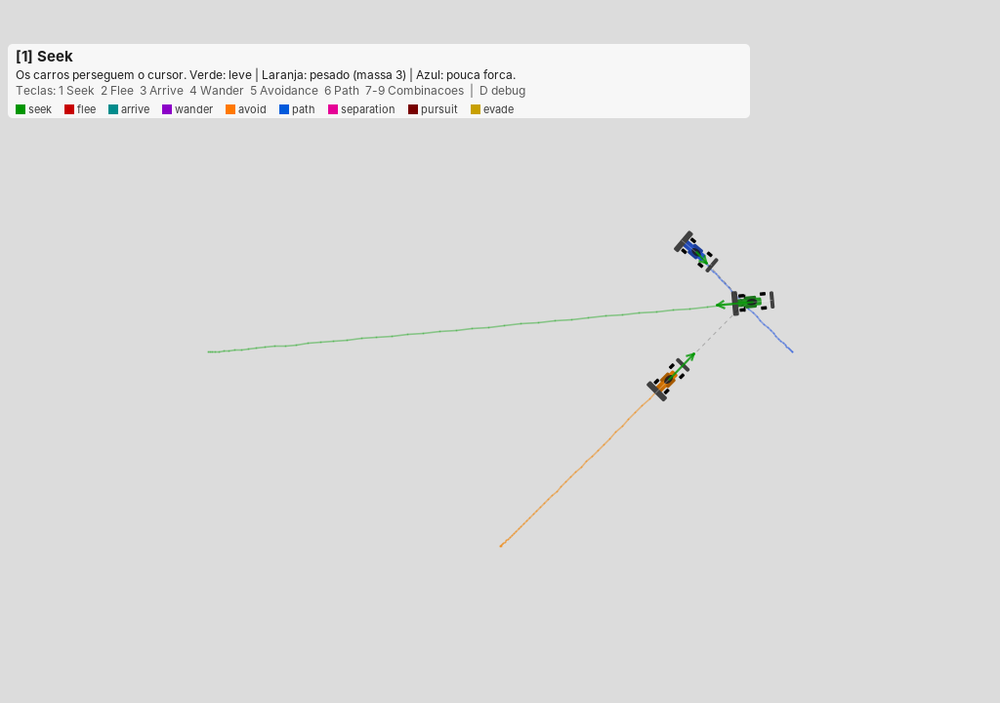
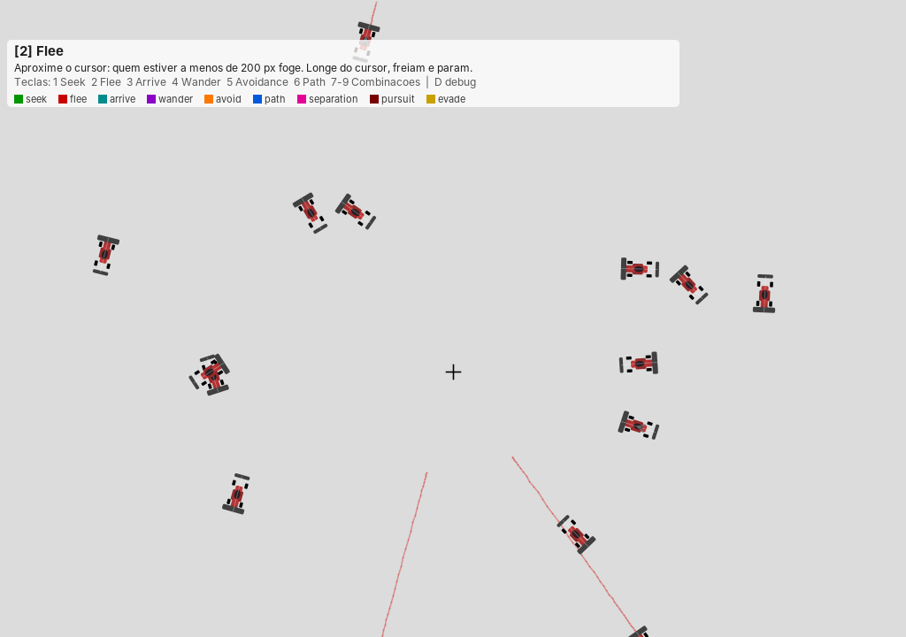
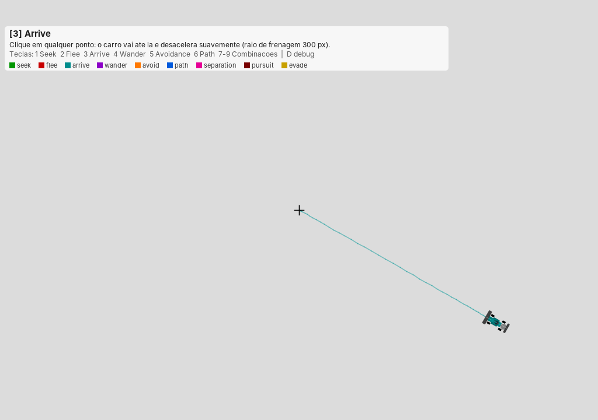
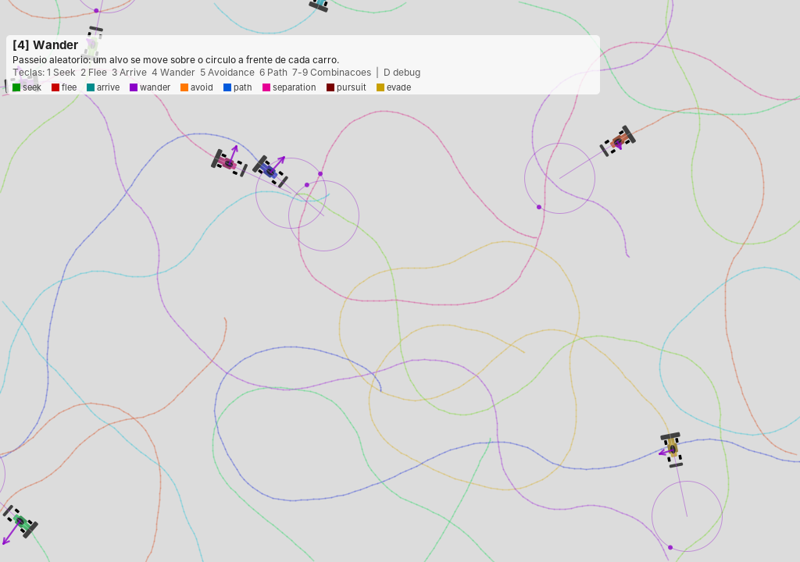
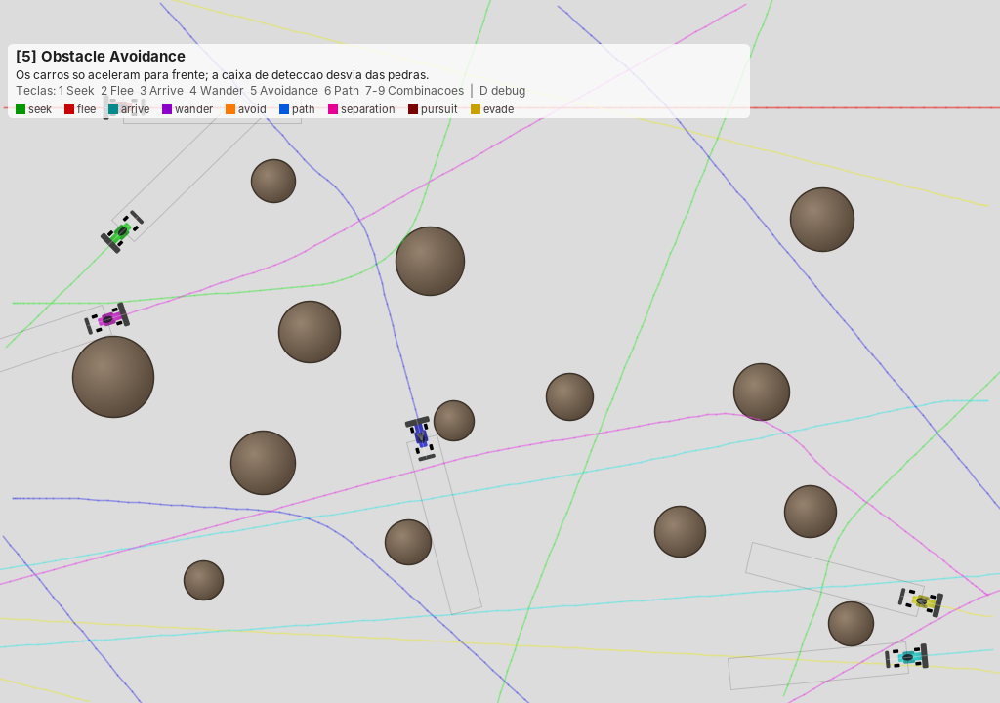
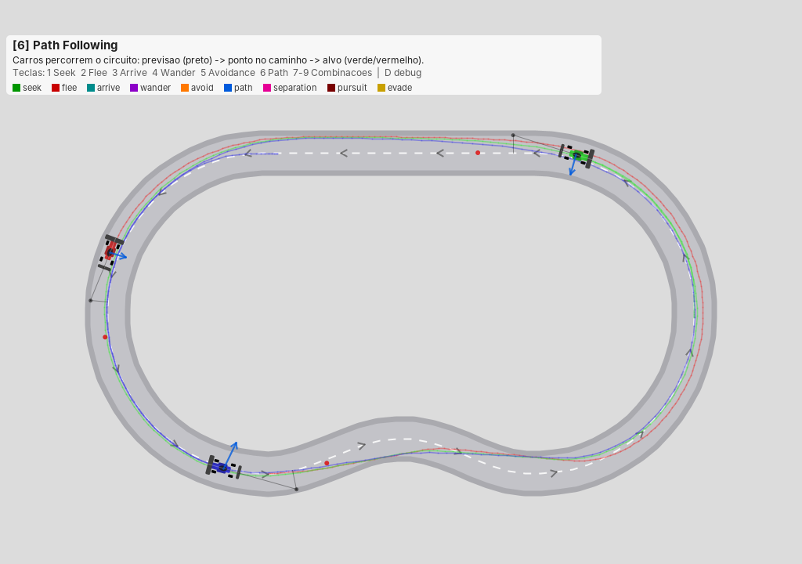
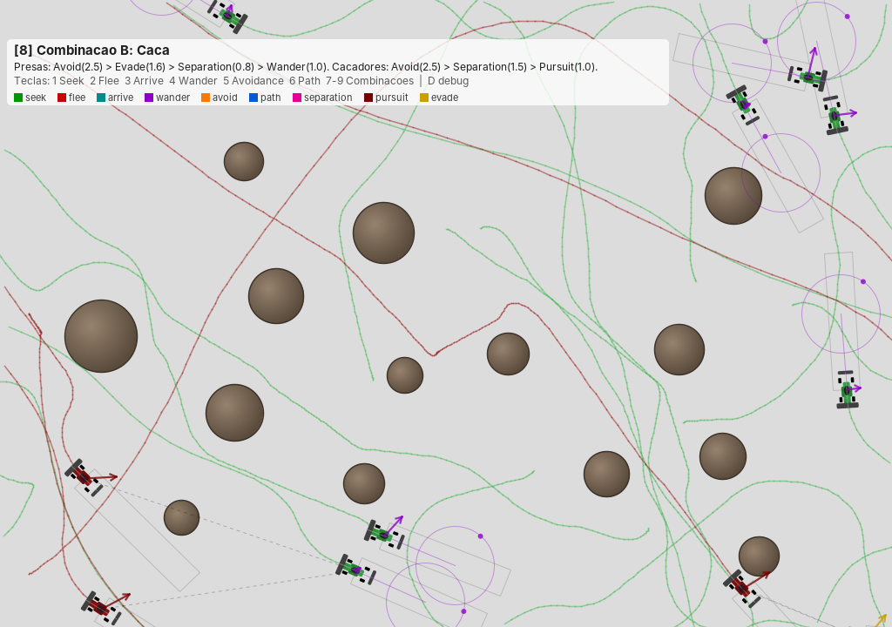
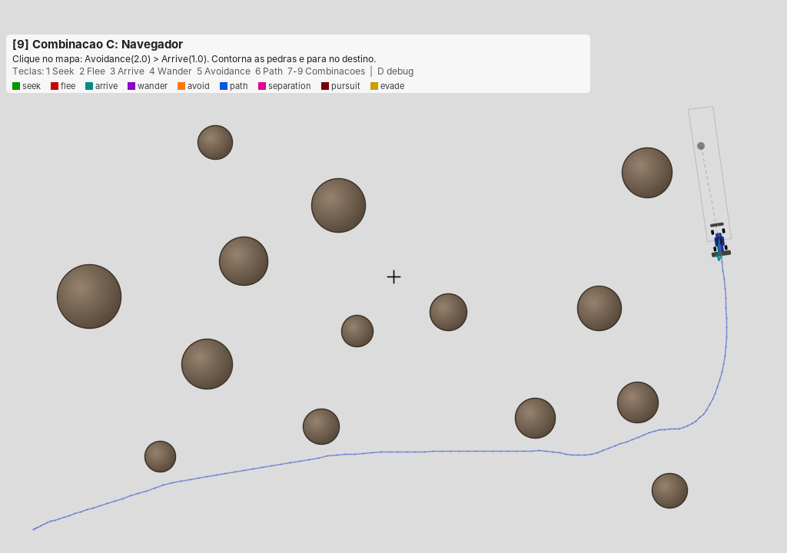

# Steering Behaviors – SBCarsEngine

Trabalho II – Steering Behaviors (Prático)
Disciplina: Inteligência Artificial e Ilusão de Inteligência em Jogos – PUCPR
Aluno: Lucas Ryan Stanczyk Brito

Artigo teórico (bônus, modelo SBC): [docs/Artigo_SteeringBehaviors_SBC.pdf](docs/Artigo_SteeringBehaviors_SBC.pdf)

Implementação dos steering behaviors de Craig Reynolds sobre a engine **SBCarsEngine** (Java 21 + Swing).
O projeto tem 4 comportamentos simples (Seek, Flee, Arrive e Wander), 2 avançados (Obstacle Avoidance e Path Following), comportamentos auxiliares (Separation, Pursuit e Evade), um mapa de testes e **3 combinações** com pesos ajustados e medidos.



---

## Como executar

Requisito: **JDK 21** ou mais recente (o projeto usa `record`, `var` e `Math.clamp`, que não existem no Java 8).

**VS Code:** instale a extensão *Extension Pack for Java*, abra a pasta do projeto, vá em *Run and Debug* (`Ctrl+Shift+D`), escolha **"Rodar o jogo"** e aperte `F5`. A pasta `.vscode` já traz as configurações.

**Windows (atalho):** dê dois cliques em `rodar.bat` ou rode `rodar.bat 7` no terminal para abrir direto no cenário 7.

**IntelliJ / Eclipse:** abra a pasta, marque `src` como *Sources Root* e execute a classe `cars.engine.Window`.

**Linha de comando:**

```bash
javac -d out $(find src -name "*.java")
java -cp out cars.engine.Window              # abre no cenário 1
java -Dscenario=7 -cp out cars.engine.Window # abre direto no cenário 7
```

### Controles

| Tecla | Cenário |
|---|---|
| `1` | Seek – os carros perseguem o cursor |
| `2` | Flee – os carros fogem do cursor |
| `3` | Arrive – clique em um ponto; o carro para nele |
| `4` | Wander – passeio aleatório |
| `5` | Obstacle Avoidance – campo de pedras |
| `6` | Path Following – circuito |
| `7` | **Combinação A – Patrulha** (Avoidance + Separation + Path Following) |
| `8` | **Combinação B – Caça** (presas com Wander + Evade; caçadores com Pursuit) |
| `9` | **Combinação C – Navegador** (Avoidance + Arrive no clique) |
| `D` | Liga/desliga o modo debug |

No **modo debug**, cada comportamento aparece como uma seta de cor própria, mostrando a força ponderada que ele realmente aplicou no quadro. Também aparecem as estruturas de percepção: o círculo do Wander, a caixa de detecção do Avoidance e a previsão do Path Following.

| Cor | Comportamento |
|---|---|
| verde | seek |
| vermelho | flee |
| ciano | arrive |
| roxo | wander |
| laranja | obstacle avoidance |
| azul | path following |
| rosa | separation |
| bordô | pursuit |
| amarelo | evade |

---

## Estrutura do código

```
src/cars/engine/      engine fornecida pela professora
   Window.java        (alterado: troca de cenário por tecla e ganchos de desenho do mapa/HUD)
src/cars/student/
   Steering.java      TODOS os comportamentos, como funções puras (carro, percepção) -> força
   SteeringMix.java   combinação de comportamentos (soma ponderada ou soma ponderada com prioridade)
   BaseCar.java       base dos carros: monta o mix e desenha o debug
   *Car.java          um carro por comportamento ou combinação (é ali que ficam os pesos)
   Arena.java         mapa de testes: obstáculos e caminho do cenário atual
   Path.java          caminho fechado com corredor, projeção e "olhar a curva à frente"
   Obstacle.java, WanderState.java, AvoidanceProbe.java, PathProbe.java
   Setup.java         monta os 9 cenários, desenha o mapa, o HUD e a legenda
tools/cars/engine/    ferramentas opcionais, fora do jogo
   Benchmark.java     roda os cenários sem janela e mede colisões, erro lateral etc.
   Snapshot.java      gera as imagens deste README
```

A única mudança na engine foi em `Window.java`:

- as teclas diferentes de `D` são repassadas ao `Setup`, que troca o cenário. Essa troca é processada dentro do *game loop*, para não haver condição de corrida;
- foram adicionados dois ganchos de desenho: `drawWorld` (antes dos carros) e `drawOverlay` (depois deles);
- o `dt` foi limitado a 0,05 s. Sem isso, arrastar a janela gera um salto de física.

### A física da engine

A cada quadro a engine faz:

```
F = truncate(steering, maxForce)
v = truncate(v + F*dt/m, maxSpeed)
p = p + v*dt
```

Todo comportamento parte da ideia central de Reynolds: **steering = velocidade_desejada − velocidade_atual**.

Essa diferença é multiplicada por `massa / TEMPO_DE_REAÇÃO`, com `TEMPO_DE_REAÇÃO = 0,25 s` (`Steering.steerToVelocity`). O resultado é a força que corrigiria a velocidade em 0,25 s. Sem esse fator, a engine levaria cerca de 1 s para reagir e os carros pareceriam "sonolentos". Como a engine trunca a força em `maxForce`, a massa passa a fazer diferença visível: um carro pesado faz curvas mais abertas.

---

## Comportamentos simples

### 1. Seek (`Steering.seek`) – tecla 1

A velocidade desejada aponta do carro para o alvo e tem módulo `maxSpeed`:

```
desejada = normalize(alvo − posição) * maxSpeed
steering = (desejada − velocidade) * m / T
```

O carro nunca desacelera, então passa do alvo e volta, orbitando em torno do cursor.

O cenário traz três carros para mostrar o efeito da física:

- **verde:** massa 1;
- **laranja:** massa 3, que faz curvas bem mais abertas;
- **azul:** `maxForce` 120, que demora a mudar de direção.



### 2. Flee (`Steering.flee`) – tecla 2

É o oposto do Seek: a velocidade desejada aponta **para longe** da ameaça. Usamos um **raio de pânico** de 200 px. Fora dele, o Flee retorna zero e um comportamento leve de "acalmar" (peso 0,25, velocidade desejada nula) faz o carro frear até parar. Sem o raio, todos os carros fugiriam para sempre, o que não parece natural.



### 3. Arrive (`Steering.arrive`) – tecla 3

É um Seek com frenagem. Dentro do **raio de frenagem** `R`, a velocidade desejada cai linearmente até zero no alvo:

```
velocidade = maxSpeed * min(1, distância / R)
```

O valor `R = 300 px` foi escolhido por experimento (ver Ajuste dos pesos, E3). A desaceleração máxima da engine é `maxForce/m = 300 px/s²`, e a distância de frenagem física a 350 px/s é `v²/2a ≈ 204 px`. Raios menores que isso fazem o carro passar do ponto.



### 4. Wander (`Steering.wander`) – tecla 4

Segue o modelo de Reynolds: um círculo (raio 45 px) é projetado 90 px à frente do carro, e o alvo do carro é um ponto sobre esse círculo. A cada quadro, o ângulo desse ponto recebe uma pequena perturbação aleatória, o que gera um passeio contínuo, sem trocas bruscas de direção.

Um detalhe: a perturbação é `N(0,1) * jitter * sqrt(dt)`, e não `* dt`. Como a soma de ruídos cresce com a raiz do tempo (passeio aleatório), isso deixa o comportamento igual em qualquer taxa de quadros.

No debug aparecem o círculo e o ponto-alvo de cada carro.



---

## Comportamentos avançados

### 5. Obstacle Avoidance (`Steering.avoidObstacles`) – tecla 5

Usa a **caixa de detecção** de Reynolds (1999), na versão de Buckland (2005):

1. Um retângulo à frente do carro, com largura igual à do carro e comprimento `110 × (1 + v/vmax)` px: quanto mais rápido o carro, mais longe ele "olha".
2. Cada obstáculo é levado para o **espaço local** do carro (`x` = à frente, `y` = ao lado). São descartados os que estão atrás, os que estão além da caixa e os com `|y| ≥ raio + meia largura`.
3. Entre os restantes, escolhemos o de **ponto de interseção mais próximo**.
4. A força tem duas partes:
   - **lateral:** empurra para o lado oposto ao centro do obstáculo. Fica mais forte quanto mais perto está o obstáculo (urgência de 1 a 2) e quanto mais centralizado ele está na caixa;
   - **frenagem:** reduz a velocidade quando o obstáculo está perto.
5. Se o carro já estiver dentro do raio expandido, recebe um empurrão radial para fora (recuperação).

No cenário 5, os carros só têm propulsão (`cruise`, que mantém a direção atual a 230 px/s) e o desvio. Todo o traçado vem do Avoidance. No debug, a caixa fica laranja e o obstáculo detectado ganha um contorno.



### 6. Path Following (`Steering.followPath`) – tecla 6

Segue o algoritmo de Reynolds:

1. **Prever** onde o carro estará: `posição + direção × (20 + 0,35·v)`.
2. **Projetar** esse ponto ortogonalmente no segmento mais próximo do caminho (`Path.project`).
3. Se a previsão sair do **corredor** (raio de 22 px), fazer Seek em um ponto 45 px à frente da projeção. Se estiver dentro, apenas manter a velocidade (Reynolds só corrige quando necessário, o que dá o leve "serpentear" de um piloto real). Também corrigimos se o carro estiver na contramão.

**Extra de realismo – frear antes da curva:** o carro olha 120 px adiante no caminho, mede o quanto a tangente gira (θ) e estima o raio da curva (`r = 120/θ`). A velocidade é então limitada a `sqrt(aLat · r)`, com `aLat = 0,8 · maxForce/m`. É a mesma conta de um piloto real: `v²/r` não pode passar da aderência. Na prática, carros rápidos freiam antes das curvas e aceleram nas retas.

O circuito é um "estádio" (curvas de raio 205 px) com uma chicane suave na reta de baixo. No debug aparecem a previsão (ponto preto), a projeção e o alvo (verde quando dentro do corredor, vermelho quando corrigindo).



### Comportamentos auxiliares (usados nas combinações)

- **Separation:** soma de vetores de repulsão dos vizinhos dentro de um raio, cada um com intensidade `(raio − d)/raio`.
- **Pursuit / Evade:** Seek/Flee na posição **futura** do outro carro, `p + v·t`, com `t = distância / maxSpeed` (limitado a 1 s).

---

## Como os comportamentos são combinados (`SteeringMix`)

Implementamos duas estratégias de Buckland (2005) para comparar:

- **Soma ponderada** (`WEIGHTED_SUM`): `F = Σ wᵢ·Fᵢ`, truncada em `maxForce`. É simples, mas forças opostas podem se cancelar, e um comportamento de baixa prioridade pode "diluir" um desvio urgente.
- **Soma ponderada truncada com prioridade** (`PRIORITIZED`, a padrão): os comportamentos são somados **em ordem de prioridade**, e cada um consome parte do "orçamento" `maxForce`. Quando o orçamento acaba, os de menor prioridade são descartados no quadro. Assim, a ordem decide *quem manda* em situação de conflito, e os pesos decidem *quanto* cada um contribui quando sobra força.

---

## Combinações

### Combinação A – Patrulha no circuito (tecla 7)

| Prioridade | Comportamento | Peso | Por quê |
|---|---|---|---|
| 1 | Obstacle Avoidance | 2,0 | Nunca bater numa pedra é mais importante que qualquer outra coisa. |
| 2 | Separation (raio 50 px) | 4,0 | Seis carros com velocidades diferentes (140 a 290 px/s) dividem a pista; os rápidos precisam ultrapassar sem encostar. |
| 3 | Path Following | 1,0 | É o objetivo, mas pode ceder momentaneamente para desviar ou ultrapassar. |

Há 4 pedras sobre a própria pista. Os carros abrem para desviar, voltam ao corredor logo depois, ultrapassam pelo lado e freiam antes das curvas. Ver a imagem do topo.

### Combinação B – Caça: presas × caçadores (tecla 8)

São dois agentes com combinações diferentes no mesmo mapa.

**Presa** (verde, 330 px/s):

| Prioridade | Comportamento | Peso | Por quê |
|---|---|---|---|
| 1 | Obstacle Avoidance | 2,5 | Mesmo fugindo, não atravessa pedras. |
| 2 | Evade (caçador mais próximo, raio 190 px) | 1,6 | Fugir só quando o perigo é real; fora do raio, vale zero. |
| 3 | Separation (40 px) | 0,8 | As presas não se sobrepõem, mas podem andar em grupo. |
| 4 | Wander (150 px/s) | 1,0 | Comportamento "ocioso" de pastar quando não há perigo. |

**Caçador** (bordô, 280 px/s, massa 1,3):

| Prioridade | Comportamento | Peso | Por quê |
|---|---|---|---|
| 1 | Obstacle Avoidance | 2,5 | Idem. |
| 2 | Separation (só entre caçadores, 90 px) | 1,5 | Espalha a matilha e evita que os três sigam em fila atrás da mesma presa. |
| 3 | Pursuit (presa mais próxima) | 1,0 | Mirar onde a presa *vai estar* parece mais inteligente que mirar onde ela está. |

O caçador é **mais lento e mais pesado** que a presa de propósito. Assim, ele só alcança quem fica encurralado entre pedras ou é pego de surpresa, e isso cria perseguições interessantes em vez de capturas imediatas.



### Combinação C – Navegador (tecla 9)

| Prioridade | Comportamento | Peso |
|---|---|---|
| 1 | Obstacle Avoidance | 2,0 |
| 2 | Arrive (ponto clicado, raio 300 px) | 1,0 |

O usuário clica em qualquer ponto do campo de pedras. O carro contorna as pedras pelo caminho e desacelera até parar exatamente no destino. É o tipo de movimento de uma unidade de RTS recebendo uma ordem de "mover para".



---

## Ajuste dos pesos (com medição)

Para não ajustar os pesos só "no olho", criamos `tools/cars/engine/Benchmark.java`. Ele roda os cenários sem janela, com passo fixo de 1/60 s, e mede:

- **colisões:** cada vez que o centro do carro entra a menos de `raio + 10 px` de uma pedra;
- **contatos entre carros:** distância menor que 20 px;
- **erro lateral:** distância ao caminho.

```bash
javac -d out $(find src tools -name "*.java")
java -cp out cars.engine.Benchmark
```

**E1 – Combinação A (6 carros, 120 s simulados)**

| Configuração (avoid / sep / path) | Modo | Colisões com pedras | Contatos entre carros | Erro lateral médio (px) | Vel. média (px/s) |
|---|---|---|---|---|---|
| só Path Following | prioridade | 281 | 40 | 8,6 | 195 |
| 2,0 / 0 / 1,0 | prioridade | 0 | 32 | 29,8 | 172 |
| 0,5 / 4,0 / 1,0 (avoid fraco) | prioridade | 192 | 3 | 36,9 | 177 |
| 2,0 / 1,2 / 1,0 | prioridade | 0 | 17 | 31,0 | 170 |
| 2,0 / 2,5 / 1,0 | prioridade | 0 | 4 | 31,8 | 174 |
| **2,0 / 4,0 / 1,0 (escolhido)** | **prioridade** | **0** | **0** | **32,7** | **174** |
| 5,0 / 4,0 / 1,0 (avoid forte) | prioridade | 0 | 3 | 32,3 | 174 |
| 2,0 / 4,0 / 1,0 | soma ponderada | 61 | 0 | 25,1 | 166 |

O que concluímos:

- **Sem Avoidance, a pista vira um "pebolim":** 281 batidas.
- Com Avoidance de peso 2,0, as batidas zeram. Com peso 0,5, o desvio fica fraco demais e o Path Following "puxa" o carro de volta para a pedra (192 batidas).
- Acima de 2,0, aumentar o peso do Avoidance não muda quase nada, porque ele já está consumindo todo o orçamento de força quando é necessário.
- O peso da **Separation** controla as ultrapassagens: 1,2 ainda deixa 17 encostadas, e 4,0 zera os contatos com custo de só ~2 px a mais de erro lateral. Por isso escolhemos 4,0.
- **A ordem de prioridade é essencial.** Com os *mesmos pesos* em soma ponderada simples, o Path Following e a Separation diluem o desvio, e aparecem 61 batidas.
- O erro lateral sobe de ~9 para ~32 px porque as pedras ocupam a pista inteira: sair do corredor para desviar é obrigatório.

**E2 – Obstacle Avoidance isolado (6 carros, 120 s)**

| Peso do Avoidance | Colisões |
|---|---|
| 0 | 343 |
| 0,5 | 15 |
| 1,0 | 7 |
| 2,0 | 8 |

Com o desvio ligado, as colisões caem 98%. As poucas que sobram são "raspões" de 1 a 5 px, quando o carro entra quase de frente numa pedra a alta velocidade logo após desviar de outra: ali o raio mínimo de curva da física (`v²/a ≈ 115 px`) não permite um desvio completo.

**E3 – Raio de frenagem do Arrive (de (−400,0) até (300,0))**

| Raio (px) | Overshoot (px) | Tempo até parar (s) | Cruzamentos do alvo |
|---|---|---|---|
| 1 (≈ Seek) | 202 | não para em 15 s | 6 |
| 60 | 151 | 7,6 | 5 |
| 120 | 98 | 5,6 | 3 |
| 220 | 15 | 4,6 | 2 |
| **300** | **0** | **4,2** | **0** |
| 400 | 0 | 5,5 | 0 |

O raio de 300 px é o menor sem overshoot. Ele também é o mais rápido para parar, e é coerente com a distância de frenagem física (~204 px) somada ao atraso de reação.

**E4 – Peso do Evade na Combinação B (média de 5 sementes, 60 s)**

| Peso do Evade | Capturas |
|---|---|
| 0 | 59,8 |
| 0,8 | 18,4 |
| 1,6 | 20,0 |
| 3,0 | 18,4 |

Ligar o Evade reduz as capturas em ~3×. A partir de 0,8 o efeito satura, pelo mesmo motivo do E1: o Evade já consome o orçamento de força disponível. Escolhemos 1,6 porque, com pesos maiores, a fuga fica "nervosa" (a presa ignora o Wander por completo assim que o caçador entra no raio).

---

## Referências

- Reynolds, C. W. (1987). *Flocks, herds and schools: A distributed behavioral model*. SIGGRAPH '87, Computer Graphics 21(4), 25–34.
- Reynolds, C. W. (1999). *Steering Behaviors for Autonomous Characters*. Game Developers Conference, 763–782.
- Buckland, M. (2005). *Programming Game AI by Example*. Wordware.
- Millington, I. (2019). *AI for Games*, 3ª ed. CRC Press.
- Shiffman, D. (2012). *The Nature of Code*, cap. 6 – Autonomous Agents.
